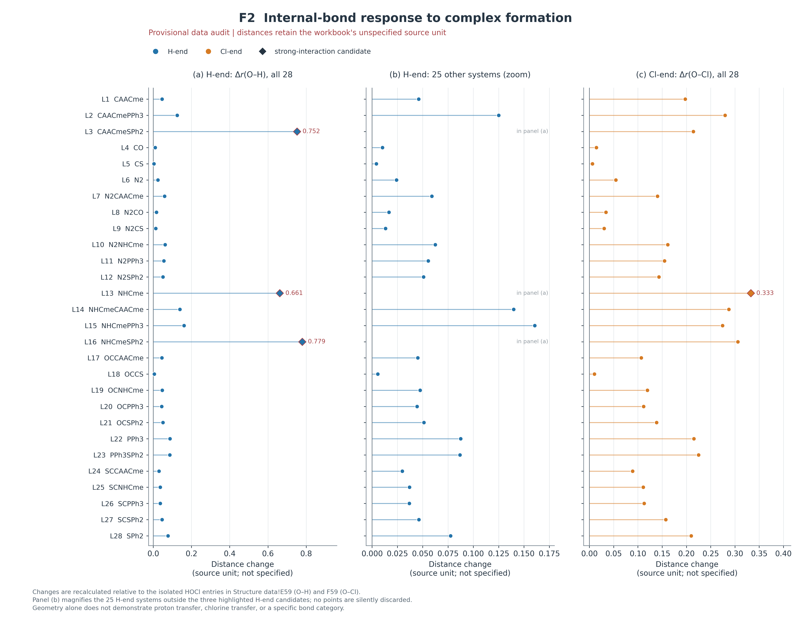
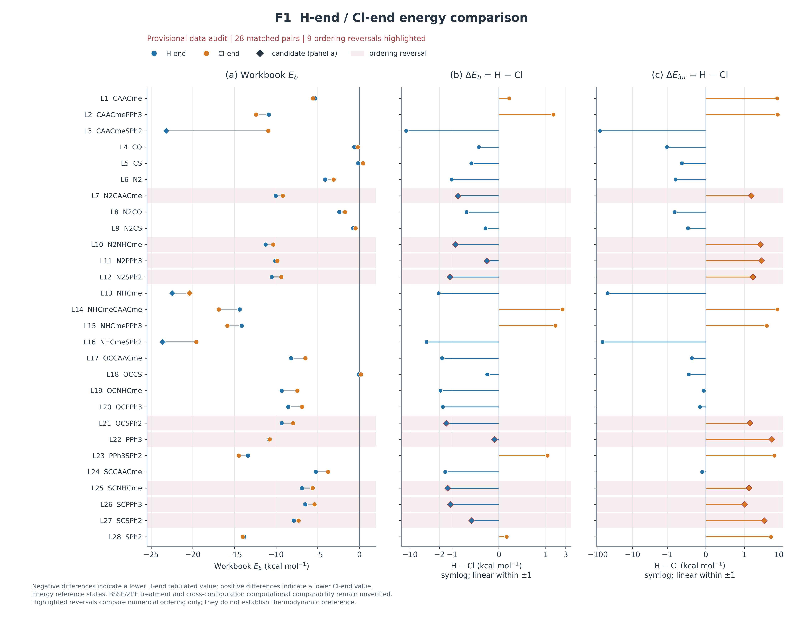
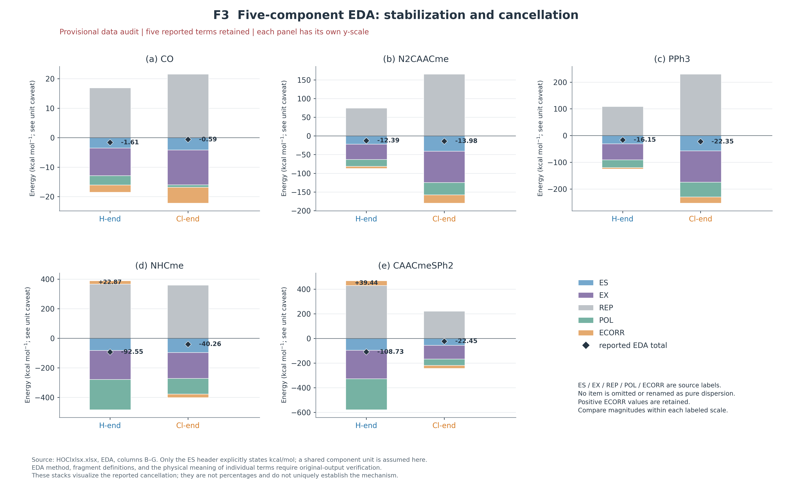
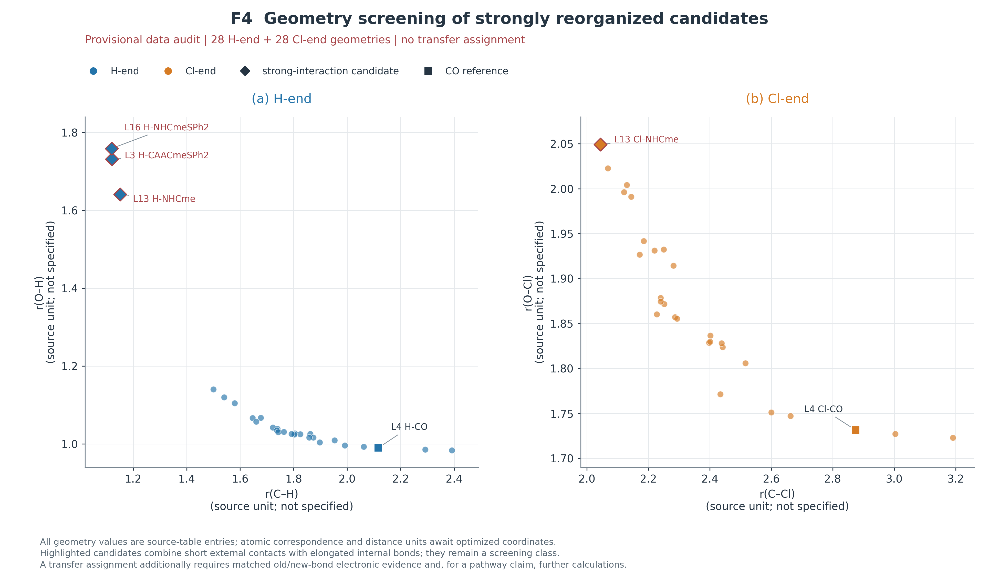

# HOCl与碳(0)化合物间氢键和卤键竞争的配体效应及成键响应

作者与单位：【待补充】

## 摘要

为考察不同配体环境下HOCl氢端与氯端的竞争关系，基于28个母体标签及其56条端构型记录，对几何、能量及电子结构数据进行统一对应，并结合分子静电势、自然键轨道、电子密度拓扑和能量分解结果分析作用差异。按表列结合能Eb，H端数值较低的有22对、Cl端较低的有6对；按相互作用能Eint比较，则分别为13对和15对，共9对出现排序反转。配对差量表明，单个相互作用指标的优势不能直接等同于净结合优势；在能量参考态与校正统一后，单体形变是值得检验的解释因素。相近的静电势可对应不同的端间排序，表列CT较大也不保证Eb更低。完整EDA展示了吸引项与排斥项的显著抵消，并有三个H端构型的ECORR为正，不能将该列未经定义改称纯色散。H-CAACmeSPh2、H-NHCme和H-NHCmeSPh2同时具有较短C—H接触、明显伸长的O—H及较大供受体微扰能，Cl-NHCme亦表现出显著O—Cl扰动，均应作为强重排候选单独讨论。现有多指标共同支持其偏离普通弱作用的讨论范围，但新旧键级、BCP身份及空间通道证据不足，尚不能确定完整质子或氯转移。由于能量定义、部分单位和运行条件仍待核实，本文建立的是可追溯的表内竞争格局及其解释边界，为后续统一参考态下的成键分析提供依据。

关键词：HOCl；碳(0)化合物；氢键；卤键；能量分解；成键响应

## 1 绪论

### 1.1 氢键、卤键及其竞争问题

氢键和卤键是具有方向性的分子间作用，在分子识别与晶体结构组织中能够参与结合位点的选择。典型氢键可表示为D—H···A，其中A向与氢原子相联系的受体轨道提供电子密度；典型卤键则可表示为R—X···A，其中与R成键的卤素原子X参与接受Lewis碱的电子供给。两类作用的接触中心不同，但其稳定化均可能涉及静电吸引、电子极化及供受体轨道相互作用。因此，同一Lewis碱能够接受氢键或卤键，并不意味着这两类构型之间存在固定的稳定性顺序。^[1,2]^

σ-hole模型为理解卤键的位点与方向提供了直观依据。共价结合的卤素原子表面具有各向异性的静电势分布，在R—X键延长线附近可出现相对缺电子的区域，从而有利于与富电子位点接近。需要区分的是，静电势能够表征孤立分子的局部电子环境，却不能直接给出结合后的全部能量变化。受体接近时产生的轨道混合、电子密度松弛与占据轨道间排斥，均可能改变最终结构。Herrmann和Svatunek对NH₃···X₂模型的研究显示，控制总吸引强度的主要因素与决定线性取向的因素并不必然相同。^[3]^

对于同时含有氢端和卤素端的分子，竞争问题还包含不同作用方式引起的结构准备代价。比较两种优化构型时，所获能量差不仅可能反映分子间吸引，也可能包含单体形变及次级接触的影响。若结合过程中原有键明显伸长，常规弱相互作用图像还可能需要向更强的成键重组描述扩展。因此，研究两端竞争需要同时明确能量参考态、内部键响应和电子结构变化，不能以接触距离或某一吸引项的大小代替完整判断。^[2,4]^

### 1.2 国外关于竞争、协同与作用来源的研究

国外对次卤酸两端竞争的研究为这一问题提供了较明确的分子模型。Alkorta等考察了HOX与NH₃、N₂和HCN（原文记为NCH）形成的复合物，获得了以O—H···N氢键及X···N卤键为主要特征的构型。在其研究范围内，较轻卤素对应的氢键构型更稳定，HOI的两类构型稳定性较为接近，HOAt则表现出卤键构型更有利的趋势。这说明，卤素变化能够改变双位点竞争结果，但该趋势受到受体种类及具体模型的限制，不能直接推出HOCl与所有Lewis碱均优先形成氢键。^[1]^

这项研究还通过NBO与电子密度分析，将受体向O—H或O—X反键轨道的供电子与内部键响应联系起来。其价值在于形成了从构型到电子结构的解释链条，而非仅给出能量顺序。供受体轨道的稳定化能描述特定轨道耦合，复合物总能量还包含其他吸引和排斥贡献，因而二者不能直接等同。^[1]^

晶体工程研究进一步揭示了几何环境和多位点作用的重要性。Awwadi等结合理论计算与卤代吡啶鎓四卤合铜盐的晶体结构，利用同构系列比较氢键和卤键的变化，说明有机卤素种类及接触几何会影响两类作用的相对表现。^[5]^Perera等将静电势分析与共晶实验结合，发现不同受体位点之间的静电势差能够影响结合位置，但选择性取决于位点差异的大小及实际结构环境。^[6]^Abeysekera等对具有多个受体位点的分子进行共晶筛选，观察到既有氢键可能保留，也可能在引入卤键给体后被重新组织。上述工作说明，分子中存在较强的局部受体并不足以独立确定最终超分子结构。^[7]^

氢键与卤键的关系还表现为协同增强。Portela和Fernández通过能量分解与NOCV分析，讨论了邻近氢键对卤键作用的影响，表明一个作用位点的结合能够改变另一位点的电子环境。^[8]^这一研究方向与两个独立优化构型之间的竞争有所区别：前者关注同一结构中相邻作用的耦合，后者关注不同结构的相对能量。两者都要求将局部电子效应置于整体复合物中理解，不能把存在氢键简单等同于卤键受到抑制。

在作用来源方面，二维形变—相互作用与能量分解分析能够同时检查距离和角度变化。Herrmann和Svatunek发现，对于其考察的I₂和Br₂模型，线性构型较低的Pauli排斥对方向性较为重要；对于Cl₂和F₂，轨道及静电作用的影响更加突出。^[3]^其意义在于指出，不能仅从不同平衡构型中最负的能量分项判断方向性的唯一来源。对于含多种配体的碳中心，配体变化可能同时改变接近距离和空间重叠，分析时尤其需要保留吸引与排斥之间的抵消关系。

### 1.3 国内研究及中外合作进展

国内研究者围绕次卤酸与不同Lewis碱的竞争作用开展了连续的理论研究。烟台大学An等以甲脒及其衍生物为受体，比较了次卤酸形成氢键和卤键的结构与电子性质。研究显示，在所考察体系中，HOCl和HOBr的氢键构型更稳定，而HOI的卤键构型更有利；取代基能够调节两类构型的能量差。甲脒复合物中还存在次级接触，环状结构的稳定性需要结合多个作用共同解释。由此，构型间能量差应理解为整体结构的差异，而非两条孤立接触的键能差。^[9]^

Li等随后研究了次卤酸与膦衍生物的复合物，将比较范围扩展至氢键、卤键和磷族键相关构型。该研究表明，不同作用可以出现在同一复合物中，取代基与卤素种类能够改变其相对贡献。例如，部分构型同时包含H···P氢键与P···X磷族键，不能统一归结为某一种作用的增强。^[2]^这些工作体现出国内研究由简单端位比较向多作用耦合分析的发展，也说明受体中心从氮变化为磷时，竞争规律需要重新检验。

在碳(0)体系方面，烟台大学与美国犹他州立大学合作的Li等研究了C(NHCMe)₂与29种含卤Lewis酸的相互作用。该文以一种碳(0)受体为基础改变Lewis酸，发现部分复合物具有常规卤键特征，而在较强作用下，卤素原子可明显向中心碳一侧重新定位。研究综合考察了几何、电子密度拓扑、NBO以及能量分解，表明中心碳的供电子行为能够伴随原有含卤键显著削弱。^[4]^该文还发现，碳(0)中心与NH₃的静电势大小相近，却表现出更强的相互作用；对于作用较弱和重排较强的不同子集，卤素种类对应的能量变化也可表现出不同顺序。^[4]^这意味着，单体静电势及常见的卤素序列适合作为比较起点，其适用范围仍须结合供电子与形变行为检验。

这一结果与本研究关注的HOCl—碳中心作用直接相关，但其变量是含卤Lewis酸种类，研究设计不同于固定HOCl并改变碳(0)配体组合的两端配对比较。

该合作研究还强调了相互作用能与结合能的区别：冻结在复合物几何中的单体与充分优化的孤立单体具有不同的参照能量，明显形变会使两种能量产生差异。^[4]^这为研究HOCl端位选择提供了重要启示，即较强的局部吸引未必对应更有利的净结合。国内已有受体取代研究与碳(0)强作用研究之间因此存在可以衔接的问题：配体改变是否同时调节供电子能力、结构形变和两端相对稳定性，需要在同一比较体系中回答。

### 1.4 碳中心供电子能力与carbene、carbone的区别

碳中心作为Lewis碱的作用需要结合其具体电子结构讨论。卡宾与碳(0)化合物均可表现出碳中心供电子能力，但二者不能作为同义名称使用。以常见单重态卡宾为参照，其碳中心具有一对主要的占据孤对电子；carbone则通常以两个配体稳定的中心碳为对象，可用L₁→C←L₂的给体稳定模型讨论，其中中心碳具有两类占据供电子轨道。这一表述体现了模型差异，并不意味着所有carbone在不同轨道局域化分析中都必须显示为两条孤对NBO。^[4]^

C(NHCMe)₂提供了这种区别的实例。Li等描述其前线轨道具有中心碳σ型和π型孤对特征，但NBO分析可将其局域化为弯曲C=C=C骨架中的双键轨道。^[4]^因此，前线轨道与NBO所得表象需要联系理解：观察到BD型供体并不能仅凭名称被改写为LP(C)，同样也不能因采用双键局域化描述就否定中心碳的供电子作用。配体对轨道能级、空间分布及分子形变的影响，应由实际结构和分析结果支持。

Alkorta和Legon对简单卡宾及其同族类似物的氢键受体能力进行了系统研究，表明取代基能够改变碳中心的亲核性。值得注意的是，对于部分二甲基卡宾与卤化氢复合物，作者根据较短的C—H距离、明显伸长的H—X键及离子对特征，将其排除在普通氢键亲核性关系的拟合之外。^[10]^这一做法为强重排体系的分组提供了参考，但卡宾—HX的经验关系不能直接用于证明carbone—HOCl已发生完整质子转移。跨物种类比能够提出待检验解释，最终分类仍需本体系的新旧键证据。

### 1.5 HOCl双端作用的研究现状与不足

HOCl在同一分子中同时具有O—H键和O—Cl键，能够使Lewis碱分别沿氢端或氯端接近，是讨论氢键与卤键竞争的适宜模型。现有含氮和含磷受体研究已表明，两端构型的能量顺序会受到受体及次级作用的影响。^[1,2,9]^碳(0)—ClOH研究则说明，氯端作用还可能伴随明显的内部键形变。^[4]^因而，固定HOCl并改变碳(0)配体组合，有助于将受体变化与端位竞争联系起来，同时检验弱相互作用解释在强结构响应条件下的适用范围。

现有研究的一个不足是，不同文献及分析方法中的能量名称并不保证具有相同参照。部分次卤酸文献所称的interaction energy以优化孤立单体为参照，另一些研究则将该名称用于冻结单体几何下的能差。^[1,4]^如果忽略这一区别，容易把形变代价造成的排序变化归入某一种吸引作用。此外，能量分解中的极化、轨道项和NBO二阶微扰稳定化能分别依赖不同定义，不能作为同一个结合强度指标相互置换。

此外，配体效应的讨论需要区分电子与空间因素。改变配体组合通常也会改变中心碳附近的可接近性、柔性及次级接触；若这些变量同时变化，某一描述符与能量差之间的相关性便不足以证明单一电子效应控制竞争。晶体多位点研究已显示结构环境的重要性，而孤立分子模型也需要检查优化后的接触是否保持同一性质。^[6,7]^

另一需要深入讨论的问题是强作用与原子重新定位之间的证据联系。Wieske和Erdélyi对卤素(I)成键的评述指出，三中心四电子卤键既可出现在带电配合物中，也可出现在整体中性的配合物中。^[11]^因此，整体电荷不能独立决定某一HOCl复合物是否适合三中心描述。仅有新接触缩短、旧键伸长或局部拓扑指标，也不足以确定完整氯转移；质子转移同样需要新旧键和片段电子结构的联合证据。静态优化终态所反映的重排迹象，还应与转移路径、势垒及形成速率区分。

### 1.6 本研究的目标与意义

基于上述进展，本研究围绕HOCl与不同配体组合的碳(0)化合物，按照“模型与位点—几何响应—两端能量—电子结构—强作用个案”的顺序展开。首先以相同母体的氢端和氯端记录为配对对象，比较内部O—H、O—Cl键及碳中心接触的变化，并在明确能量定义和校正口径的基础上讨论相对稳定性。由此区分分子间作用强度与净结合稳定性，避免将某一局部指标直接当作端位偏好的判断标准。

其次，将NBO供受体分析、电子密度拓扑与能量分解相结合，考察配体变化是否伴随不同的电子供给及吸引—排斥抵消模式。各分析方法分别回答轨道供电子方向、局部密度特征和能量组成问题，既关注相互支持的证据，也保留指标排序不一致的情形。对于几何重排明显的构型，单独讨论其是否超出常规弱氢键或卤键的描述范围，不预设其必然发生质子或氯转移。

研究结论的适用范围限定于所采用的计算模型和比较条件。优化构型之间的电子能差不能自动换算为溶液中的构型比例，也不能说明哪一种接近方式形成更快。只有在统一单体参照、热修正与环境条件后，才能进一步讨论相应热力学问题；转移路径与势垒则需要另有势能面证据。保持这些层次的区分，有助于使配体调节规律与特殊成键解释建立在可复核的依据之上。

本研究希望回答三个相互联系的问题：配体变化如何影响中心碳与HOCl两端的结合；两类构型的相对能量与几何准备、静电及电子重排之间具有何种联系；哪些体系表现出需要进一步成键验证的结构响应。通过统一配对比较和多证据分析，可以为理解碳(0)受体的端位选择提供具体依据，并明确当前计算资料所能支持的结论范围及后续验证方向。

## 2 理论基础与计算方法

### 2.1 理论方法与证据范围

本文以作者独立计算所得的工作簿为定量分析基础，按结构响应、能量比较和电子结构分析的逻辑组织结果。现有资料能够核实数据转录、差量计算及图表生成过程，尚不能复验原始量子化学作业。原大纲列出的BP86/def2-TZVP、Gaussian 09、ADF 2013中的BP86-D/TZ2P以及GKS-EDA/XEDA/Mokit，均作为方法声明保留；大纲又将部分设置归于参考文献，故不将其直接写成本项目已采用的运行条件。文献中的理论水平亦不用于反填本研究参数。^[4]^

【待核实—运行条件】需依据原始输入输出集中补全：各类计算的程序及修订号、泛函和基组、色散方案及适用步骤、优化与频率关键词、数值积分和收敛设置、片段电荷及自旋、BSSE校正、溶剂模型，以及零点能和热修正。未提供的信息不默认等于气相、未校正或使用程序默认值。

### 2.2 研究模型与数据对应

依据`HOClxlsx.xlsx`的“编号对照”建立L1—L28及H端、Cl端名称，按体系名称连接各表，不按行号拼接。MEP含28个母体名称，其余主要分析表分别覆盖56条两端记录；名称层面未见重复或缺项。[D01] H端和Cl端仅表示原记录的作用取向，不预先限定最终成键类型。完整配体组成、原子编号、电子态及优化后连接方式仍须坐标确认；`CSNHCme`与`SCNHCme`的关系保留核查标记。

原始值与衍生量分开保存，缺值保持为空，不以零代替。逐值记录文件、工作表和单元格；正文以[D01]—[D17]连接来源索引。所有原始数据按作者要求保留，异常记录单独标记，不以删除或改值获得预期趋势。原始精度与正文显示精度区分处理，排版中的小数位数不代表计算准确度；从公式缓存提取的数值另与输入值复算核对。追溯表同时保留命名与来源位置，使后续更正能够定位到具体记录，而不覆盖原始资料。

### 2.3 几何结构与频率信息

几何比较采用“结构数据”中的接触距离、HOCl内部键及其变化量。内部键变化按Δr=r复合物−r单体独立复算，单体基准取该表E59、F59的0.9795和1.71675；其数值与缓存变化量一致，但距离单位、单体理论水平及“结合角”的原子顺序尚待核实。[D03] 在此之前，图轴注明原表未标单位，不自行补写Å或度。

“NBO主表”汇总的56条虚频数均为零，最低频率均为正；该记录仅支持频率汇总层面的描述。[D01] 原始频谱、优化收敛及正常结束状态未被重新检验，故不据此宣称已逐个确认全部局部极小值。显著短接触与内部键伸长用于筛选重排候选，成键归属另结合电子结构证据判断。候选在全体图中保留并使用独立符号；其余点仅表示未被当前筛查优先标记，不自动归为普通弱相互作用组。低频记录也不用于推断具体振动模式或热修正大小。

### 2.4 能量定义与两端比较

“bess”表中的Eint和Eb按原列名、原符号及kcal·mol⁻¹保存。能量参照态尚未明确，本文首先定义可直接复算的δb=Eb(H)−Eb(Cl)、δint=Eint(H)−Eint(Cl)及g=Eb−Eint。负的δ仅表示对应H端表列值较低，g仅称数值差。[D04]、[D05] 只有确认两端组成、电子态、方法、参考单体和校正一致，才能赋予其相对结合稳定性的解释。

为核对原始输出，待确认的统一方案为：Eint=EAB(RAB)−EA(RA@AB)−EB(RB@AB)，Eb=EAB(RAB)−EA(RA⁰)−EB(RB⁰)。其中A、B分别为碳(0)化合物与HOCl，@AB表示复合物中的单体几何，R⁰表示孤立优化几何。仅在基组、片段态及校正一致时，二者之差才可对应单体形变代价；目前不将g命名为形变能。表名亦不足以证明已实施BSSE校正。电子能排序不换算为溶液比例、自由能或形成速率；文献中同名能量也须先核对定义。^[1]^

### 2.5 分子静电势分析

静电势按原字段分组。“MEP”表B列标为中心碳附近Vs,min，单位为kcal·mol⁻¹，共24个值；另有4个值仅位于C列，字段名称及单位未证实与B列相同，故不直接补入。[D02] 探索图仅比较同字段数据与两端能量差的共同变化，不拟合预设关系，也不据此确定配体效应的因果来源。表面等密度值、取极值区域及计算条件待补；单列数值不足以重建真实静电势表面。

### 2.6 NBO与WBI分析

NBO分析保留主供体、主受体及最大E(2)的原始归属。供体既含LP也含BD，受体分别涉及HOCl的O—H或O—Cl反键轨道，不统一改写为“中心碳孤对电子供给”。[D07] E(2)属于二阶微扰稳定化指标，不等于复合物结合能，其通道求和也不作为总键能。对异常大E(2)单独讨论，并要求结合占据数、能级差和Fock矩阵元检查微扰解释的适用性。

CT保留为原表数值；电荷方案、片段划分、正号及单位未确认前，不表述为确定转移了多少电子。[D08] WBI为无量纲指标，现仅H-CO填写，其他记录保持缺失，不能建立全系列键级趋势。[D10] 强重排候选需补新旧键成对WBI及电荷证据后再分类。

### 2.7 AIM/QTAIM分析

拓扑分析分别记录ρ、∇²ρ及表列H。只有确认BCP原子对、单位和定义，才能将其解释为特定接触处的电子密度、拉普拉斯量及局部总能量密度；局部H不与体系结合能混称。[D09] 不以单一符号或数值阈值判定共价性。现有数据缺少HOCl原有键与新接触的成对拓扑证据，故与几何、NBO联合用于筛选候选，不直接确认完整质子或氯转移。

### 2.8 EDA、NOCV与图表复现

EDA按原表保留ES、EX、REP、POL和ECORR五项，计算Σ₅=ES+EX+REP+POL+ECORR及残差R=EDA_E−Σ₅。[D11] 五项与总量各保留两位小数时，以0.03作为保守舍入界限；跨表两项同量比较以0.01为界，仅用于算术审计。超界项保留原值并追查输出。EX不省略，ECORR不直接称纯色散，POL不等同ETS轨道能；分项抵消以完整正负柱及总量展示，不用净能量作分母计算贡献百分比。[D12] EDA仅ES表头明示单位，其余项在审阅图中暂按共同单位展示并保留限制。GKS-EDA与ETS-NOCV的片段参考与分项口径须分别核实，不跨框架加和。分项大小与方向性也须区分。^[3]^

“NOCV”仅提供Energy，单位及其为总量或通道量均未明确；缺少特征值和形变密度时不制作通道图。[D13] 各分析目前仅完成同名连接，尚需同几何和波函数索引确认可比性。Python脚本从冻结JSON读取数据，输出逐图CSV，并以Matplotlib生成PNG、SVG及PDF；来源文件SHA-256用于识别输入变化。复现检查覆盖原值、差量和图表文件，不等于完成原始计算验证，也不补造误差棒或电子密度图。各图固定体系顺序，标明纳入和排除规则；分面比较使用明确轴标，不以隐藏极端点制造趋势。若后续实施相关分析，应预先确定分组并检查重排候选对结果的影响。

## 3 HOCl–碳(0)体系的几何结构、能量及竞争规律

### 3.1 体系对应与中心碳静电环境

依据编号对照表，当前数据由28个母体标签及其H端、Cl端记录构成，共56条构型记录。结构、能量、NBO、AIM、EDA与NOCV各表按体系名称连接后，均覆盖相同的56个名称，未发现命名重复、缺项或额外构型。这里的H端与Cl端沿用原数据的取向标签，不预先等同于普通氢键和普通卤键。完整配体组成、中心碳原子编号及优化后连接方式仍为【待补充】，因而名称对应不能替代分子结构对应。尤其“CSNHCme不在研究范围内”与“SCNHCme被保留”的命名关系，应在结构表中明确，而不能自行将二者合并或增补。[D01]

MEP表中，24个体系的数值位于标为“Vs,min(C), kcal/mol”的B列，另4个只在C列“Vsurfs,min”填写。B列中CO为+5.521087、CS为+0.024254，NHCme为−36.437157，SPh2为−43.907279，说明所记录的中心碳附近静电指标随母体标签明显变化。但是，C列未说明是否采用同一等密度面、同一取点区域和同一单位，因此N2CS、SCCAACme、SCNHCme和SCPPh3的C列值不与B列拼接。补图S2仅展示24个B列有效点，并在图注中列明排除原因。[D02]

单体静电指标可以为接近方向提供初始线索，但不能独立决定两端竞争。CAACmeSPh2与N2CAACme的B列数值分别为−28.710342和−28.591889，接近程度较高，而其H减Cl的Eb差分别为−12.260855和−0.873322 kcal/mol。另一方面，SPh2具有上述更负的MEP值，其Eb却仅以0.166745 kcal/mol的表列差偏向Cl端。这些反例说明，一个单体静态极值不足以同时描述两种结合端的轨道匹配、形变和整体接触环境；它们并不证明静电作用不重要，也不能据此将差异唯一归因于另一分项。[D02,D04] 相关文献对碳(0)中心的研究同样表明，接近的静电势可以对应明显不同的结合强度，但该认识的迁移仍应限定于实际模型。^[4]^

### 3.2 HOCl内部键响应与构型差异

几何数据采用表列游离HOCl的O—H=0.97950、O—Cl=1.71675为差量基准。56条构型的Δr(O—H)和Δr(O—Cl)均可由相应内部键长减去该基准复算，公式缓存与独立复算一致。图3-4以H端Δr(O—H)及Cl端Δr(O—Cl)分别展示两类取向的内部键响应，不将不同原子对的距离直接解释为同一成键尺度。当前单位和基准理论水平仍为【待核实】，正文和图轴保留“原表距离单位未注明”的限定。[D03]

以CO为参照，H端的C···H距离为2.11684，O—H为0.98984，较表列单体伸长0.01034；Cl端的C···Cl为2.87467，O—Cl为1.73130，伸长0.01455。与强重排候选相比，这一对构型的HOCl内部键变化较小，可以作为低响应参照，但不能仅凭较长接触或较小伸长认定其全部相互作用均为纯静电或完全非共价。[D03] 以同一母体的两个取向分别考察被扰动内部键，比将所有接触距离放在一个强度排序中更有明确的结构意义。

三个H端构型呈现明显不同的响应：H-CAACmeSPh2、H-NHCme和H-NHCmeSPh2的C—H距离分别为1.12139、1.15136和1.11974，而O—H分别达到1.73117、1.64089和1.75861，较单体基准伸长0.75167、0.66139和0.77911。这里描述的是C—H距离在当前H端样本中较短，以及O—H相对已列单体基准伸长，并没有同一体系反应前C—H键可供讨论其“缩短量”。图3-4将三者单独标记，并保留完整范围及其余体系的局部视图，避免极端点掩盖其他结构响应。[D03,D14]

Cl端也出现连续变化。Cl-NHCme的C—Cl和O—Cl分别为2.04473和2.04933，O—Cl相对单体伸长0.33258；该构型的两个距离接近，提示需同时考察新旧接触的电子结构。由于C与O具有不同的共价环境，等距离并不是氯转移的普遍分界。图5-1采用C···H与O—H、C···Cl与O—Cl的成对几何散点进行筛查，属于由真实表列数据绘制的指标图，并非优化结构或反应路径图。[D03,D15]

{width=100%}

图3-4 HOCl内部键长响应（F2）。(a)全部28条H端Δr(O—H)；(b)其余25条H端记录的局部视图，三个优先候选仍完整保留在(a)，不将其余记录自动称为弱作用；(c)全部28条Cl端Δr(O—Cl)。差量由结构数据!E2:F57分别减去E59=0.97950、F59=1.71675复算。来源单位未注明，图轴保留原表距离单位；三H候选及Cl-NHCme单独标记。图示内部键响应，不能凭几何独自确定质子/氯完整转移。

### 3.3 两端结合能比较及能量指标引起的排序变化

为使符号保持一致，定义δb=Eb(H端)−Eb(Cl端)，δint=Eint(H端)−Eint(Cl端)。负值表示H端相应表列值更低，正值表示Cl端更低。图3-5并列展示两端Eb及两种差量。按Eb比较，28对中H端较低22对、Cl端较低6对；Cl端较低的名称为CAACme、CAACmePPh3、NHCmeCAACme、NHCmePPh3、PPh3SPh2和SPh2。若改按Eint，则H端较低13对、Cl端较低15对。两种指标对同一配对矩阵给出了不同的总体排序，说明“相互作用较强”与“净结合数值较低”不能在文字中混用。[D04]

9对体系发生排序反转，分别为N2CAACme、N2NHCme、N2PPh3、N2SPh2、OCSPh2、PPh3、SCNHCme、SCPPh3和SCSPh2，且均为Eint的Cl端更低、Eb的H端更低。例如N2CAACme的δint为+1.590 kcal/mol，δb为−0.873322 kcal/mol；PPh3的两个差量分别为+6.200和−0.096009 kcal/mol。前者表明不同能量口径可能改变相对次序，后者还提示，即便Eint有较大的端间差异，Eb差也可能接近零，不能仅据Eint讨论最终取向选择。[D05]

为分析差异来源，本文另列g=Eb−Eint，但在能量定义未确认前，只称其为“表列差量”。代数上必有δb−δint=g(H端)−g(Cl端)。对N2CAACme，g(H端)=2.341227、g(Cl端)=4.804549 kcal/mol，二者之差为−2.463322 kcal/mol，恰对应排序改变所需的差额。若Eint和Eb分别对应统一冻结单体与孤立优化单体参考，且校正方式一致，这一差额可解释为两端形变代价的不同；若两列还存在BSSE、热修正或方法差别，则不能将其全部归为形变能。因此，该分析目前建立的是可复算的能量关系，尚未证明形变是全部反转的唯一原因。[D05] 文献中对相互作用能和结合能的明确区分支持这一核查方向，而不能替代本研究的实际公式。^[4]^

整个矩阵中，δb从CAACmeSPh2的−12.260855至NHCmeCAACme的+2.522590 kcal/mol，显示不同配体标签对应的端间差别并非只改变强弱，也可能改变符号。然而，CAACme、SPh2和PPh3的δb分别仅为+0.221028、+0.166745和−0.096009 kcal/mol。文件没有提供方法误差、零点能、构象或溶剂敏感性评估，这些小差值只能报告原符号与数值，不能表述为稳健的选择性，更不宜据此估计溶液中两构型比例。图中没有为这些点添加未经计算的误差棒。[D04,D17]

近零结合还需与“存在接触”区分。Cl-CS的Eint和Eb分别为+0.38和+0.445532 kcal/mol；Cl-OCCS则为−0.02和+0.172565 kcal/mol。后一例说明，即使某一相互作用指标略负，也不保证以另一参考态计算的结合量为负。当前信息不足以把正Eb归因于某个具体校正或断言结构不存在；频率表记录的无虚频也不等于该结构相对于孤立单体必然具有负结合能。[D06]

{width=100%}

图3-5 28对体系的两端Eb与竞争差量（F1）。(a)表列H端与Cl端Eb配对；(b)δb=Eb(H)−Eb(Cl)；(c)δint=Eint(H)−Eint(Cl)。来源为HOClxlsx.xlsx的bess!B2:C29、F2:G29及编号对照。负差表示H端表列值较低，正差表示Cl端较低。阴影标记9对排序反转；(a)菱形标记三个H端候选及Cl-NHCme。(b)(c)采用标明的symlog坐标，±1以内线性，刻度仍为实际kcal/mol，不能按线段长度直接比较能量倍数。参考态及BSSE/ZPE未核实，图示不等于有限温度热力学或动力学偏好。

表3-1

| 编号/体系 | Eb(H) | Eb(Cl) | δb | δint | Eb表内低值端 |
| --- | --- | --- | --- | --- | --- |
| L1 CAACme | -5.333835 | -5.554863 | 0.221028 | 8.870000 | Cl |
| L2 CAACmePPh3 | -10.868285 | -12.393322 | 1.525038 | 9.130000 | Cl |
| L3 CAACmeSPh2 | -23.192770 | -10.931914 | -12.260855 | -86.280000 | H |
| L4 CO | -0.602410 | -0.174448 | -0.427962 | -1.020000 | H |
| L5 CS | -0.144327 | 0.445532 | -0.589859 | -0.620000 | H |
| L6 N2 | -4.105210 | -3.087788 | -1.017422 | -0.780000 | H |
| L7 N2CAACme | -10.048773 | -9.175451 | -0.873322 | 1.590000 | H |
| L8 N2CO | -2.409638 | -1.719377 | -0.690261 | -0.810000 | H |
| L9 N2CS | -0.740462 | -0.453941 | -0.286521 | -0.460000 | H |
| L10 N2NHCme | -11.268963 | -10.344484 | -0.924479 | 2.880000 | H |
| L11 N2PPh3 | -10.110441 | -9.851907 | -0.258534 | 3.120000 | H |
| L12 N2SPh2 | -10.505772 | -9.382530 | -1.123243 | 1.760000 | H |
| L13 NHCme | -22.471133 | -20.394000 | -2.077133 | -52.280000 | H |
| L14 NHCmeCAACme | -14.363076 | -16.885667 | 2.522590 | 8.960000 | Cl |
| L15 NHCmePPh3 | -14.135290 | -15.840172 | 1.704882 | 4.430000 | Cl |
| L16 NHCmeSPh2 | -23.622488 | -19.573543 | -4.048946 | -73.510000 | H |
| L17 OCCAACme | -8.201556 | -6.475903 | -1.725652 | -0.360000 | H |
| L18 OCCS | -0.078439 | 0.172565 | -0.251004 | -0.440000 | H |
| L19 OCNHCme | -9.324171 | -7.437249 | -1.886923 | -0.050000 | H |
| L20 OCPPh3 | -8.545431 | -6.888805 | -1.656626 | -0.150000 | H |
| L21 OCSPh2 | -9.336721 | -7.963102 | -1.373619 | 1.450000 | H |
| L22 PPh3 | -10.867218 | -10.771209 | -0.096009 | 6.200000 | H |
| L23 PPh3SPh2 | -13.372238 | -14.473895 | 1.101657 | 7.330000 | Cl |
| L24 SCCAACme | -5.210216 | -3.764432 | -1.445783 | -0.090000 | H |
| L25 SCNHCme | -6.883785 | -5.609939 | -1.273845 | 1.360000 | H |
| L26 SCPPh3 | -6.493712 | -5.396586 | -1.097126 | 1.030000 | H |
| L27 SCSPh2 | -7.870858 | -7.290411 | -0.580447 | 3.740000 | H |
| L28 SPh2 | -13.832830 | -13.999575 | 0.166745 | 5.870000 | Cl |

能量单位kcal/mol，差量统一H减Cl。来源：HOClxlsx.xlsx的bess列B/C/F/G及编号对照；逐值见D04/D05。参考态、BSSE和ZPE待核实。

### 3.4 按名称对应的配体系列及几何—能量关系

几何变化与能量差可以相互提供线索，但两者回答的问题不同。内部O—H或O—Cl伸长反映表列终态中相应键的结构响应；Eb与Eint则还涉及参考态及整个复合物的能量。不能将H端C···H与Cl端C···Cl距离直接混入同一经验回归，因为原子种类、轨道和参照长度均不同。图3-4与图5-1分端作图，并在本文中保留候选类别，而不使用全样本单一直线支持统一成键模型。

按名称对应的N2、OC和SC系列能够提供比单点排序更有结构的比较。在共同另一名称组分为CAACme、NHCme、PPh3和SPh2时，共有四组三元系列；各组两端Eb均沿N2→OC→SC的名称顺序变得较不负，而12对的Eb都以H端较低。这里的“系列”只表示数据标签对应，完整结构仍待核对，不能把它当作已经控制其他条件的单配体替换实验。整体结合幅度随名称系列变化，而端间差的方向保持相同，说明“整体更易结合”和“更偏向某一端”是两个需要分别讨论的结果。[D16]

以CAACme对应组为例，N2CAACme、OCCAACme和SCCAACme的H端Eb分别为−10.048773、−8.201556和−5.210216 kcal/mol，C···H分别为1.73914、1.82451和1.95226，CT表值分别为0.11301、0.08287和0.04883。这组记录中，更负的Eb、较短接触与较大CT呈相同的组内排序，可作为几何与电子响应相互呼应的例子。但Cl端并不保证各指标同序，例如N2SPh2、OCSPh2和SCSPh2的C···Cl为2.22756、2.29370和2.24013，CT为0.26800、0.25746和0.26336，后两者不再沿相同方向变化。[D16]

这些成组结果的适用范围是限定的：H端某些系列中观察到的一致排序，不足以建立整个样本的普遍关系，更不能把CT变化指定为距离变化的原因。配体几何、接近方向、孤立单体的电子和形变状态可能同时改变。对SCNHCme，还存在EDA与bess总量不一致，不能将其用于未经限定的分项机制归因。因而本文先报告成组对应和反例，未进行将所有端、所有候选混合的统计拟合。

三个H端强重排候选尤其说明这一必要性。它们的Eint分别为−108.73、−92.54和−110.48 kcal/mol，Eb则为−23.192770、−22.471133和−23.622488 kcal/mol，Eb−Eint达到85.537230、70.068867和86.857512 kcal/mol。如此大的表列差量，应首先引导检查冻结片段、优化单体及其校正口径，而不能简单写成“氢键比其他体系强数倍”。即使后续确认该差量主要来自形变，其物理意义也是相互作用吸引与重组代价的共同作用，并非一种可忽略代价的额外稳定化。[D14]

结合图3-5和结构响应，下一步机制分析应集中于两个问题：一是为何部分构型具有更负Eint却没有更低Eb；二是为何部分H端终态表现出明显O—H伸长。前者需要EDA与能量参考态相结合，后者需要几何和电子结构的对应证据。二者可能有关，但目前不能把“更大形变”“更强极化”和“已经发生转移”写成同义结论。

## 4 电子结构与稳定化来源

### 4.1 NBO供受体通道及表列CT

NBO主表所列H端受体均为O—H的BD\*，Cl端均为O—Cl的BD\*，与两种取向可能扰动的内部键一致。该结果在轨道标签层面支持分别考察向O—H和O—Cl反键轨道的电子给予，但主供体并不全部是中心碳孤对电子：56条中37条写为LP、19条写为BD；分端为H端LP17/BD11，Cl端LP20/BD8。H-CAACme和Cl-CAACme均以BD(2) C23—C36为主供体，H-CO则为LP(1) C4。因而正文采用“占据供体轨道向相应反键轨道的作用”，保留实际LP或BD归属，不将局域化得到的成键轨道改写为不存在的LP(C)。[D07]

这种区分对于碳(0)体系具有具体意义。相关文献以C(NHCMe)2为例指出，前线轨道具有两类供电子特征，而NBO局域化仍可给出弯曲C=C=C的双键描述；不同表象并不意味着可以在记录中互换LP和BD。^[4]^ 目前缺少本研究完整轨道、自然占据、Fock矩阵元和能隙，尚不能据一条主通道确定所有体系的电子给予方式完全相同，也不能将配体对中心碳的影响压缩为单个孤对电子能量的变化。

H-CO的最大E(2)=10.21 kcal/mol，而其Eb为−0.602410 kcal/mol，二者数值和定义显然不同。三个H端候选的最大E(2)分别为606.65、539.62和630.08 kcal/mol，Cl-NHCme亦达到259.29 kcal/mol。这些数值可以提示强供受体混合与二阶微扰解释的适用性需要复核，却不能作为真实键能直接相加。目标通道E(2)求和同样不是总相互作用能；当前缺少筛选规则，不能据求和大于某阈值定义成键类型。[D07,D14] 次卤酸—含氮碱的研究也指出，NBO供受体作用能可能明显大于净相互作用能，排斥等作用必须共同考虑。^[1]^

表列CT提供了另一组有意义的反例。28对中26对的Cl端CT数值更大，但这26对中有20对仍是H端Eb更低；仅CAACmeSPh2和NHCmeSPh2表现H端CT大于Cl端。以CO为例，Cl端CT为0.036044、H端为0.01745，而H端Eb更低；NHCme也表现Cl端CT=0.51867大于H端0.47638，但Eb仍以H端较低。这些结果否定了“表列CT更大必然对应更低Eb”的简单排序规则。CT尚未明确电荷方案、片段和正方向，本文不补写电子单位，也不将该反例理解为电荷转移与稳定化毫无联系。[D08]

### 4.2 AIM/QTAIM与WBI的对应证据

AIM表为每条构型提供ρ、H和∇²ρ，但没有BCP坐标、原子对和单位。为避免预设，以下称“表列局部拓扑指标”，不直接把每个数都认定为指定C···H或C···Cl接触的BCP。H端有6条∇²ρ为负，分别为CAACmePPh3、CAACmeSPh2、NHCme、NHCmeCAACme、NHCmePPh3和NHCmeSPh2；Cl端28条均为正。三个优先强重排候选只是H端负值集合的一部分，因此负拉普拉斯不能单独用作质子转移筛选标准。[D09]

以H-NHCmeCAACme和H-NHCmePPh3为例，表列∇²ρ分别为−0.04069、−0.062028，O—H为1.11930、1.14020，与H-NHCme的1.64089存在明显差别。它们可能属于不同程度的增强作用或重排，但现有数据不足以根据拉普拉斯同号就归为相同终态。相反，H-NHCme与Cl-NHCme的表列H均负，∇²ρ却异号，也不宜将这种差异直接写成一端共价、另一端非共价。应在BCP身份确认后，将各指标与新旧键的完整拓扑共同分析。[D09,D16]

WBI本应为新旧键对应关系提供独立补充，但现表仅H-CO填写C—H、C—Cl、O—H、O—Cl四个值，依次为0.0287、0.0031、0.7414、1.0041。该组数据可用于描述H-CO在当前键级方案下的局部对照，不能推及其余55条，更不能用缺失值0代替。对三个H端候选及Cl-NHCme，WBI均为【待补充】。因此，本文不绘制全体系WBI趋势图，也不把缺失的键级证据写成已完成验证。[D10]

### 4.3 EDA分项抵消与净能量

当前EDA表列ES、EX、REP、POL、ECORR及总量E。五分项均保留后，以Σ5=ES+EX+REP+POL+ECORR进行复算。55条记录与表列总量的差在0.02以内，只有H-N2NHCme的五项和为−13.88而总量为−13.70，差0.18。另有Cl-NHCmeSPh2和Cl-SCNHCme的EDA总量分别为−36.89和−9.99，与bess的−36.97和−10.49不同。补图S1将表内闭合与跨表差异分开显示。这里0.03和0.01仅为显示到两位小数时的舍入审计界限，不是方法误差或显著性阈值；没有调整任何原值来消除差异。[D11]

图4-8选择CO、N2CAACme、PPh3、NHCme和CAACmeSPh2各两端，保留全部五项并独立标出总量。所选样本包含低响应参照、排序反转及强H端候选，目的是比较吸引与排斥抵消，而非以最大负项给作用“定性”。例如H-NHCme的ES=−82.17、EX=−196.71、REP=+367.13、POL=−203.66、ECORR=+22.87，五项和为−92.54，表列总量−92.55 kcal/mol；Cl-NHCme相应为−96.81、−174.21、+360.20、−106.30、−23.14，总量−40.26。H端更负的POL与Cl端更负的ES、ECORR同时存在，说明净差异来自多项变化，不能从其中一项的大小独自推出完整结合偏好。[D12]

进一步以H端减Cl端的分项差比较NHCme，可得到ΔES=+14.64、ΔEX=−22.50、ΔREP=+6.93、ΔPOL=−97.36和ΔECORR=+46.01 kcal/mol。按当前列名和同单位假设，POL差是所列分项中幅度最大的H端有利变化，但ES、REP和ECORR的差同时抵消了它的一部分；五个差量合计−52.28，与bess中两端Eint的差相同。该算术分解比单看“POL最负”更直接地呈现竞争：它说明某一局域分项的优势需要在其余项共同变化后才转化为净相互作用差，也不等于Eb具有同样大的端间差。[D12]

PPh3则可说明EDA如何与Eb分开解释。其H端EDA总量为−16.15、Cl端为−22.35 kcal/mol，与表列Eint的Cl端更低一致；但两端Eb分别为−10.867218和−10.771209，差值符号反向且很小。因此，解释EDA各分项更有利，只是在相应片段与几何参考下说明净相互作用的变化，仍需结合Eb及其参考条件才能讨论结合后的构型排序。对反转体系而言，不能仅展示一个Cl端负项更大的柱图，就据此宣布卤键构型更稳定。[D05,D12]

三个H端候选的ECORR分别为+39.44、+22.87和+41.54，明确不能将整列统一当作吸引项。原表没有给出ECORR的具体方法定义，因此正文不将其改称纯色散，也不把正值解释为“色散排斥”。EX与REP在该表分列，不能省去EX后仍称完整分解；两者是否可组合为特定方法中的交换排斥，需完整GKS-EDA定义确认。ETS-NOCV的轨道项可能包含电荷转移和极化，与本表POL也不是可逐项替代的量。[D11,D12] 不同分解框架回答的物理问题存在交集，但分项命名和片段参考必须分别保持。^[4]^

图4-8只作平衡终态的分项比较，不声称解释了方向性或形成路径。已有二维能量分解研究表明，净吸引的主要来源与线性构型偏好的主要来源可以不同，且不同平衡距离会影响分项绝对值。^[3]^ 本研究没有相应角度—距离扫描，因此将静电、极化和排斥的变化视为受限机制线索，而不据终态柱图建立单一因果链。相对贡献百分比也暂不绘制，因为ECORR有正有负且方法定义未明，分母选择会显著改变所谓贡献率。

{width=100%}

图4-8 代表体系的完整EDA分项与总量（F3）。CO、N2CAACme、PPh3、NHCme和CAACmeSPh2各H/Cl两端，以ES、EX、REP、POL、ECORR原列名正负堆叠，菱形为表列EDA总量。来源为EDA!B5:G5/B33:G33、B8:G8/B36:G36、B23:G23/B51:G51、B14:G14/B42:G42、B4:G4/B32:G32。仅ES列头明确kcal/mol，本图其余分项暂按同单位展示并待核实；各子图使用独立且明示的纵轴尺度，不跨面板按柱高比较。保留正ECORR，不把它改称纯色散；全部分项参与抵消，不计算未定义贡献百分比。该图不能单独解释方向性或Eb排序。

表4-3

| 构型 | ES | EX | REP | POL | ECORR | 表列E |
| --- | --- | --- | --- | --- | --- | --- |
| H-CO | -3.50 | -9.38 | 16.92 | -3.18 | -2.47 | -1.61 |
| Cl-CO | -4.17 | -11.81 | 21.59 | -0.82 | -5.38 | -0.59 |
| H-N2CAACme | -22.05 | -40.76 | 74.57 | -18.49 | -5.65 | -12.39 |
| Cl-N2CAACme | -40.89 | -83.71 | 165.53 | -33.04 | -21.87 | -13.98 |
| H-PPh3 | -30.74 | -60.37 | 109.09 | -28.43 | -5.70 | -16.15 |
| Cl-PPh3 | -57.33 | -117.36 | 230.41 | -55.46 | -22.61 | -22.35 |
| H-NHCme | -82.17 | -196.71 | 367.13 | -203.66 | 22.87 | -92.55 |
| Cl-NHCme | -96.81 | -174.21 | 360.20 | -106.30 | -23.14 | -40.26 |
| H-CAACmeSPh2 | -95.63 | -231.17 | 429.72 | -251.09 | 39.44 | -108.73 |
| Cl-CAACmeSPh2 | -55.69 | -111.18 | 220.70 | -52.30 | -23.98 | -22.45 |

保留EDA全部原列。仅ES列头明示kcal/mol，其余同单位暂作审阅图假设；不把ECORR改称纯色散。来源D12。

### 4.4 NOCV字段的现有信息与分析边界

NOCV表目前仅提供标为Energy的单一数值字段，分别列出两端记录，没有单位、轨道对编号、特征值、分通道能或形变密度。H-NHCme与Cl-NHCme分别为−115.80和−70.63，H-CAACmeSPh2与H-NHCmeSPh2分别为−139.37和−140.10。它们可以作为待核实字段保存在总表中，但尚不能称为总相互作用能、总轨道能或某个主导通道能，更不能与POL、E(2)或Eb直接相加比较。[D13]

因此，本文不绘制推测性的NOCV等值面，也不凭NBO通道标签反向生成NOCV轨道图。最小补充需求是确认该字段含义及计算层级，并优先取得CO、NHCme两端的通道能、特征值和真实形变密度。在相同几何及片段参考下，才可检验电子耗尽/积累方向是否与NBO识别的O—H或O—Cl反键给予一致。缺少这些数据不会推翻已核算的能量排序，却限制了对轨道空间机制的表述深度。

### 4.5 多方法之间的一致与不一致

当前可建立的共同线索是：取向标签与NBO受体键相符；三个H端候选同时具有较短C—H、较长O—H及很大E(2)，并伴随不同于低响应参照的局部拓扑指标。然而，“方向相符”不等于已实现全部方法的一致验证。CT并不与Eb一一同序，拉普拉斯负值也不限于三个候选，WBI和NOCV空间证据仍缺。不同工具分别描述几何、局域轨道、密度拓扑或能量分解，其量纲和参照不同，允许存在不同的排序。

特别需要复核H-CAACmeSPh2的ρ=0.1299。H-NHCmeSPh2的ρ=0.2595，约为前者两倍，而两者C—H为1.12139与1.11974，H为−0.25209与−0.25150，∇²ρ为−0.86575与−0.85970，均相近。这一可疑跨体系差异既可能涉及BCP选取、导出或录入，也不能排除真实电子结构差别。由于缺少原始BCP身份，本文保留两值，将其列作核查点，不以猜测数字修正，也不选择性忽略它来宣称证据完全一致。[D09,D14]

## 5 强相互作用候选中的质子重新定位与C—Cl成键证据

### 5.1 分层讨论的依据

本文采用“低响应参照—其他待分类记录—优先强重排候选”的工作性分层，目的在于组织证据而非建立普遍成键阈值。H-CO可作为较小内部键响应的参照；H-CAACmeSPh2、H-NHCme和H-NHCmeSPh2因几何与多项电子指标共同异常而优先单列；Cl-NHCme作为Cl端重点个案。其余记录不能仅因未进入上述名单就被全部称为弱作用。图5-1展示分端几何筛查，表5-1汇集代表性证据，并把未提供的新旧键WBI和内部键BCP明确列为空缺。[D03,D09,D10,D14,D15]

这一分层避免将可能偏离普通微扰图景的记录并入同一经验趋势。卡宾氢键研究中，带有显著离子对特征的样本也曾被从普通亲核性拟合中分离讨论。^[10]^ 该方法可作为处理异常的参考，但卡宾不等于碳(0)化合物，也不存在可直接搬用的通用距离或能量分界。现有分类最终仍需本体系原始几何和成对成键指标支持。

{width=100%}

图5-1 新旧接触的分端几何筛查（F4）。(a)28条H端r(C—H)对r(O—H)；(b)28条Cl端r(C—Cl)对r(O—Cl)，来源结构数据!C2:F57。菱形突出H-CAACmeSPh2、H-NHCme、H-NHCmeSPh2及Cl-NHCme，方形为两端CO参照。距离保留原表数值，单位与原子号待核；不同面板比较不同原子对，不建立通用等距离转移阈值。此图为表列几何的真实数据图，不是优化分子结构图、NOCV图或反应路径；候选分类尚需新旧键配对电子结构证据。

表5-1

| 构型 | C—H或C—Cl | O—H或O—Cl | 表列ρ | 表列∇²ρ | E(2)最大 | 新旧键WBI |
| --- | --- | --- | --- | --- | --- | --- |
| H-CO | 2.11684 | 0.98984 | 0.021310 | 0.047310 | 10.21 | H-CO已有，见正文 |
| Cl-CO | 2.87467 | 1.73130 | 0.016140 | 0.049100 | 7.72 | 【待补充】 |
| H-NHCme | 1.15136 | 1.64089 | 0.239700 | -0.745800 | 539.62 | 【待补充】 |
| Cl-NHCme | 2.04473 | 2.04933 | 0.108080 | 0.053840 | 259.29 | 【待补充】 |
| H-CAACmeSPh2 | 1.12139 | 1.73117 | 0.129900 | -0.865750 | 606.65 | 【待补充】 |
| Cl-CAACmeSPh2 | 2.22059 | 1.93115 | 0.074110 | 0.093470 | 37.53 | 【待补充】 |
| H-NHCmeSPh2 | 1.11974 | 1.75861 | 0.259500 | -0.859700 | 630.08 | 【待补充】 |
| Cl-NHCmeSPh2 | 2.06895 | 2.02260 | 0.102510 | 0.069420 | 197.58 | 【待补充】 |

几何和拓扑字段的单位及BCP原子对待核实，E(2)为kcal/mol；缺失WBI不填0。来源D03/D09/D10/D14/D15。

### 5.2 H端：质子向碳侧偏移的静态迹象

对三个H端候选，质子相对C与O的位置是首要几何信息。在当前表列终态中，其C—H约1.12—1.15，而O—H约1.64—1.76，后者相对游离基准明显伸长；与CO等低响应样本相比，质子明显更靠近中心碳一侧。三个体系还同时具有较大表列CT、数百kcal/mol的E(2)及负的局部H和∇²ρ。这些证据共同支持将其描述为“质子重新定位或质子转移样结构候选”，比将其直接纳入普通弱氢键更符合现有记录。[D14]

但上述判断仍有清晰边界。当前没有完整坐标供核对全部连接方式，没有新C—H与残余O—H的成对WBI、BCP及自然占据，也没有与孤立质子化母体/去质子化片段的一致参考比较。极大的二阶微扰能本身还需要检查局域Lewis结构和供受体能隙。因而尚不能确定三者分别属于高度共享质子、离子对或其他强混合终态，更不能只因O—H较长就写成已经获得完整质子转移产物。H-CAACmeSPh2的ρ异常也使其拓扑证据必须单独保留核查。

能量方面，三个候选虽然具有很负Eint，但Eb的幅度明显较小，说明必须把强吸引与参考态代价共同讨论。若后续确认Eb−Eint主要是形变，结构重排可能与较大的几何准备代价相联系；现阶段这仍是条件解释，而不是已经分离得到的变形机制。优化终态本身也不能说明转移如何发生。只有要讨论路径和势垒时，才需沿O—H与C—H坐标进行适量扫描，并对相关过渡态和连接关系作验证；本文不根据端点虚构势垒或速率。

### 5.3 Cl端：新旧接触同步响应及文献对照

Cl-NHCme的C—Cl=2.04473、O—Cl=2.04933，O—Cl相对单体伸长0.33258；表列ρ=0.10808、H=−0.03745、∇²ρ=+0.05384，CT=0.51867，主导E(2)=259.29 kcal/mol。几何与电子指标共同提示Cl端存在较强接触和明显内部键扰动，但当前只能确认表列信息的对应关系，BCP原子对和CT定义仍需核实。尤其其O—Cl的内部BCP和WBI未提供，不能仅由外部接触数据量化新旧键强弱的转移。[D15]

上传文献中，C(NHCMe)2与ClOH的相应构型给出C···Cl=2.040 Å、O—Cl=2.049 Å，相互作用能−40.24、结合能−20.39 kcal/mol，并结合内部与外部BCP和参考结构讨论显著卤素位移。^[4]^ 本研究Cl-NHCme的数值与其接近，可以作为受限对照；但本研究完整组成仍需结构确认，其几何单位与方法也不能由接近程度反推。文献值不填入本研究缺失列，尤其不能将文献O—Cl的ρ当作本研究已有内部键证据。

目前适合的结论是：Cl-NHCme应列为强Cl端作用及氯转移样结构的重点候选，现有资料尚不足以确定完整氯转移或新的成键形式。相似的限制也适用于其他Cl端组合体系。强卤键、三中心成键和卤素转移之间的关系需要具体参考态和完整电子结构支持，相关评述提供了概念框架，也涉及整体中性的卤素(I)配合物；本研究HOCl复合物是否适合三中心四电子描述，仍需明确的片段参照与对应成键证据，不能仅凭两段距离接近确定。^[11]^ 如欲讨论氯转移路径，应补充连接端点的势能证据，而不是将静态两距离接近作为反应机制。

### 5.4 配体组合与异常响应的比较

配体组合比较首先显示“含某一配体就必然偏某一端”的规则并不成立。NHCme的δb为−2.077133 kcal/mol，NHCmeCAACme和NHCmePPh3分别为+2.522590、+1.704882，而NHCmeSPh2又为−4.048946。相应H端O—H分别为1.64089、1.11930、1.14020和1.75861，说明表列能量符号改变并不总伴随同一方向或相同程度的几何响应。该比较支持组合环境与两端竞争相关，但完整分子组成未确认前，不能将其简单写成单一取代基效应或定量电子效应。[D16]

CAACme与CAACmeSPh2的对照同样具有启发性。两者δb分别为+0.221028和−12.260855，H端Δr(O—H)分别为0.04602和0.75167，前者较小、后者进入优先强重排候选范围。与此相对，N2CAACme的H端Δr(O—H)=0.05895，虽然其MEP与CAACmeSPh2相近，却没有相同程度的内部键伸长。可能同时参与的因素包括中心碳供电子轨道、配体构型和位阻环境，但当前没有固定几何下的控制比较，无法将差异唯一归于其中之一。[D02,D16]

因此，现有资料支持的研究认识有三个层次：数据直接支持两种能量指标存在不同的配对排序、配体标签对应不同的内部键响应，以及少数H端记录具有联合异常；受条件约束的解释是形变代价与分项抵消可能影响净结合竞争；需要进一步验证的假设是部分终态已进入质子或氯转移、离子对或新共价成键区域。优先补充同几何原始能量、异常行EDA、新旧键WBI/BCP和少数NOCV通道，即可针对这些具体疑问增加证据，无需先扩展至全部无关计算。

## 6 结论与展望

### 6.1 两端竞争的主要结果

本研究依据同名构型对齐的几何、能量与电子结构数据，建立了28个母体标签、56条H端和Cl端记录的统一比较。名称层面未发现重复或遗漏，但完整化学组成与优化终态仍需坐标确认，故H端、Cl端首先是原数据的取向标记。按Eb比较，H端表列值较低22对、Cl端较低6对；按Eint比较，则为H端13对、Cl端15对。9对排序反转均由Eint的Cl端较低变为Eb的H端较低，说明结合后的净能量排序不能由相互作用能单独替代。这里的计数不意味着22对均属于普通氢键胜出，也不代表有限温度下的构型比例。[D01,D04,D05]

δb=Eb(H)−Eb(Cl)与δint=Eint(H)−Eint(Cl)的符号统一，使配体之间的竞争差别能够直接复算。近零差与较大的负差应区分解释：前者需构象和方法敏感性支持，后者也须确认两端的参考单体与校正一致。现阶段以g=Eb−Eint记录差量，只有在实际定义符合冻结与优化单体参考、且其他处理相同时，才可解释为相应形变代价。由差量恒等式识别潜在形变影响是合理分析方向，但不能将未经拆分的全部差异预先归因于形变。[D05,D17]

### 6.2 配体效应与电子结构认识

配体标签变化同时对应单体静电指标、接触几何和净结合数值的变化，但目前不支持单一描述符决定端偏好的规则。相近MEP可对应不同的δb，28对中有26对的Cl端CT表值较大，而这26对中有20对仍为H端Eb更低。NBO主供体同时包含LP与BD记录，也表明不能将整个样本统一写为中心碳孤对电子向反键轨道给予。更可靠的分析方式是保留实际轨道标签，在相同体系和几何对应下比较受体轨道、局部密度与完整能量分项。[D02,D07,D08]

EDA五项的完整保留揭示了较大吸引与排斥之间的抵消。某个分项更负并不自动对应更低的总相互作用能，更不自动对应更低Eb。ECORR存在正值、POL的精确定义尚未确认，因而不能将二者分别固定称为纯色散和纯电荷转移。AIM指标与几何有部分共同响应，但负拉普拉斯不限于三个优先H端候选；WBI仅一条构型可用，NOCV缺少通道与密度，因此当前证据尚不能组成完整的多方法成键确认。[D09,D10,D11,D12,D13]

### 6.3 强重排候选的判断范围

H-CAACmeSPh2、H-NHCme和H-NHCmeSPh2同时表现质子向碳侧偏移的几何特征与明显电子指标变化，应从普通弱作用经验趋势中单列。Cl-NHCme则具有较短C—Cl接触与伸长的O—Cl，适合作为Cl端重点个案。上述判断来自多项信息的共同筛查，强于单一距离判据，但仍不等于完整质子转移、完整氯转移、离子对或特定共价结构已经确定。H-CAACmeSPh2的ρ差异还需原始BCP输出复核，不能以其他指标相近为由忽略。[D14,D15]

### 6.4 研究局限与后续验证

本研究当前最重要的局限在于原始计算条件和若干字段定义尚未得到输入输出确认。下一步应先澄清Eint/Eb、CP及ZPE处理，解决三处EDA差异，再核对少数代表和异常构型的坐标、片段态及新旧键WBI/BCP。这样能够直接回答排序反转与成键分类两个关键问题，比增加大量缺乏明确用途的计算更有效。NOCV宜从少数代表构型补齐真实通道与形变密度，随后检验其与NBO标签的一致性。

若研究目标进一步涉及“如何转移”及势垒，应在静态终态确认后增加相应势能扫描与过渡态连接验证；若要讨论溶液中的丰度，则需明确溶剂、热修正和构象处理。现有数据不承担这些尚未完成的结论。总体而言，本研究的价值在于将两端竞争、配体变化和强重排候选置于同一可追溯框架，明确哪些结果已经由表列数据支持、哪些解释依赖参考态、哪些成键假设仍需补证。

## 参考文献

[1] ALKORTA I, BLANCO F, SOLIMANNEJAD M, et al. Competition of hydrogen bonds and halogen bonds in complexes of hypohalous acids with nitrogenated bases[J]. The Journal of Physical Chemistry A, 2008, 112: 10856–10863. DOI: 10.1021/jp806101t.

[2] LI Q Z, ZHU H J, ZHUO H Y, et al. Complexes between hypohalous acids and phosphine derivatives. Pnicogen bond versus halogen bond versus hydrogen bond[J/OL]. Spectrochimica Acta Part A: Molecular and Biomolecular Spectroscopy, 2014[2026-10-18]. DOI: 10.1016/j.saa.2014.05.001. https://doi.org/10.1016/j.saa.2014.05.001.

[3] HERRMANN B, SVATUNEK D. Directionality of halogen-bonds: insights from 2D energy decomposition analysis[J]. Chemistry – An Asian Journal, 2024, 19: e202301106. DOI: 10.1002/asia.202301106.

[4] LI S H, ZHOU H Y, LI Q Z, et al. Strong interactions between carbones and halogen atomic centers[J]. Chemical Science, 2026, 17: 14950–14962. DOI: 10.1039/d6sc02210c.

[5] AWWADI F F, TAHER D, HADDAD S F, et al. Competition between hydrogen and halogen bonding interactions: theoretical and crystallographic studies[J]. Crystal Growth & Design, 2014, 14: 1961–1971. DOI: 10.1021/cg500094b.

[6] PERERA M D, DESPER J, SINHA A S, et al. Impact and importance of electrostatic potential calculations for predicting structural patterns of hydrogen and halogen bonding[J]. CrystEngComm, 2016, 18: 8631–8636. DOI: 10.1039/c6ce02089e.

[7] ABEYSEKERA A M, AVERKIEV B B, SINHA A S, et al. Establishing halogen-bond preferences in molecules with multiple acceptor sites[J/OL]. ChemPlusChem, 2021, 86[2026-10-18]. DOI: 10.1002/cplu.202100102. https://doi.org/10.1002/cplu.202100102.

[8] PORTELA S, FERNÁNDEZ I. Nature of the hydrogen bond enhanced halogen bond[J]. Molecules, 2021, 26: 1885. DOI: 10.3390/molecules26071885.

[9] AN X L, ZHUO H Y, WANG Y Y, et al. Competition between hydrogen bonds and halogen bonds in complexes of formamidine and hypohalous acids[J]. Journal of Molecular Modeling, 2013, 19: 4529–4535. DOI: 10.1007/s00894-013-1969-7.

[10] ALKORTA I, LEGON A. Simple carbenes as hydrogen bond acceptors: ab initio determination of nucleophilicities and reduced nucleophilicities[J]. Physical Chemistry Chemical Physics, 2025, 27: 942–950. DOI: 10.1039/d4cp03894k.

[11] WIESKE L H E, ERDÉLYI M. Halogen bonds of halogen(I) ions—Where are we and where to go?[J]. Journal of the American Chemical Society, 2024, 146: 3–18. DOI: 10.1021/jacs.3c11449.
