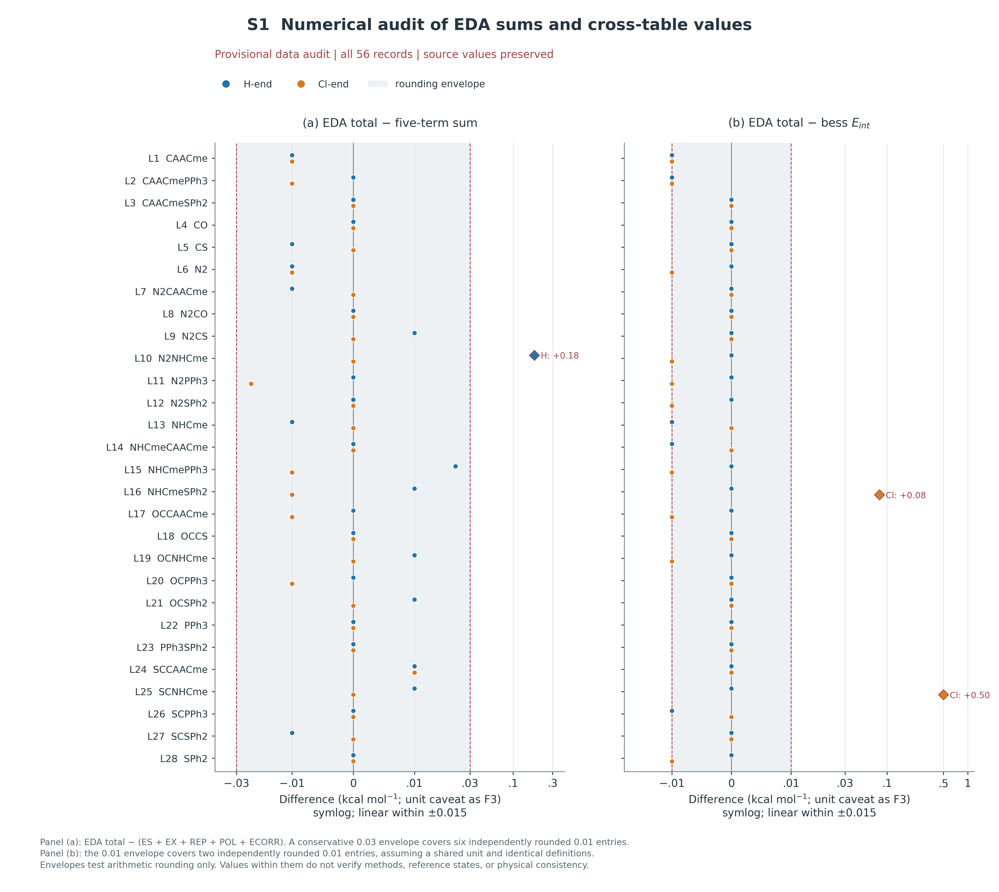
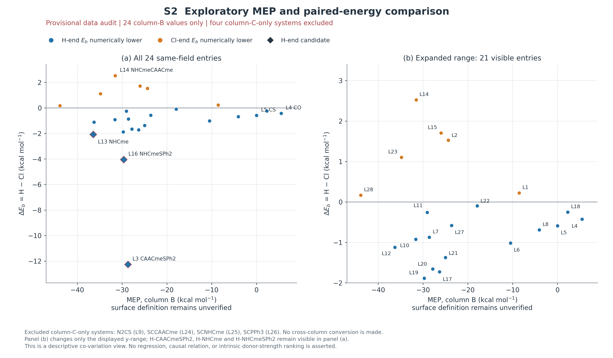

# 补充材料与待核实事项

## 摘要及全文统计的追溯说明

摘要的28/56来源D01，22/6、13/15及9反转来源D04/D05；候选与EDA符号来源D11/D14/D15。正文沿用[D01]—[D17]，逐值来源见data/数据来源索引.csv（2733条）。所有原值与bess保留，核查只证明转录和算术一致，不代替原始作业验证。

## S1 数据来源与核查范围

[Dxx]指向data/数据来源索引.csv；每条包含体系、指标、原值、原表单元格。下面给出用途和核心来源范围，逐值表为机器可复核版本。

|索引|对应内容|原始来源|
|---|---|---|
|D01|体系命名、覆盖与频率汇总|HOClxlsx.xlsx：NBO主表、编号对照；逐值单元格见CSV|
|D02|MEP原字段及反例|HOClxlsx.xlsx：MEP；逐值单元格见CSV|
|D03|全部几何、基准与距离差|HOClxlsx.xlsx：结构数据；逐值单元格见CSV|
|D04|全28对能量排序及范围|HOClxlsx.xlsx：bess；逐值单元格见CSV|
|D05|九对反转与Eb-Eint表列差量|HOClxlsx.xlsx：bess；逐值单元格见CSV|
|D06|正或近零结合量|HOClxlsx.xlsx：bess；逐值单元格见CSV|
|D07|NBO通道身份、计数和E2|HOClxlsx.xlsx：NBO主表；逐值单元格见CSV|
|D08|CT端比较及与Eb反例|HOClxlsx.xlsx：NBO、bess；逐值单元格见CSV|
|D09|局部拓扑符号与rho可疑差异|HOClxlsx.xlsx：AIM、结构数据；逐值单元格见CSV|
|D10|WBI可用与缺失|HOClxlsx.xlsx：结构数据；逐值单元格见CSV|
|D11|EDA完整求和与跨表差|HOClxlsx.xlsx：EDA、bess；逐值单元格见CSV|
|D12|代表体系EDA及配对抵消|HOClxlsx.xlsx：EDA、bess；逐值单元格见CSV|
|D13|NOCV Energy字段，含义未知|HOClxlsx.xlsx：NOCV；逐值单元格见CSV|
|D14|三个H端优先强重排候选|HOClxlsx.xlsx：AIM、NBO、NBO主表、bess、结构数据；逐值单元格见CSV|
|D15|Cl-NHCme重点个案|HOClxlsx.xlsx：AIM、NBO、NBO主表、bess、结构数据；逐值单元格见CSV|
|D16|按名称对应系列及混配比较|HOClxlsx.xlsx：NBO、bess、结构数据；逐值单元格见CSV|
|D17|近零端间差|HOClxlsx.xlsx：bess；逐值单元格见CSV|

衍生量统一为δb=Eb(H)−Eb(Cl)、δint=Eint(H)−Eint(Cl)、g=Eb−Eint、R=EDA_E−Σ5。D05表列差量未自动命名形变能；D11/S1的舍入界限仅用于算术审计。任何BCP、CT或NOCV字段身份未核实处均不得据文献反填。

## S2 统计口径与证据限制

H/Cl标签表示原表取向，统计分母固定为28对或56条构型。CT的26/20表示28对中26对Cl端表值更大，其中20对仍为H端Eb较低。LP/BD计数为原表主供体类别，BCP身份、单位和跨分析几何仍待原始输出确认。近零差没有方法误差棒，不推算平衡丰度或速率。

## S3 补充图

{width=100%}

图S1 EDA求和与跨表能量审计。(a)R=EDA总量−(ES+EX+REP+POL+ECORR)；(b)EDA总量−bess Eint，均按体系名对应全部56条记录。阴影±0.03与±0.01分别为五项/总量和两列均独立保留0.01精度时的舍入包络，不是理论准确度或统计误差。H-N2NHCme残差+0.18、Cl-NHCmeSPh2跨表差+0.08、Cl-SCNHCme跨表差+0.50分别标注，未改任何原值。横轴标明symlog及线性区间±0.015；接近零不能证明方法、几何和参考态一致。单位限制同图3。

{width=100%}

图S2 同字段MEP与两端Eb差的探索性比较。横轴仅为MEP!B2:B29中24个非空的Vs,min(C)表值，表头单位kcal/mol；纵轴为bess所得δb，亦为kcal/mol，二者虽同单位却不是同一物理量。四个仅C列体系N2CS、SCCAACme、SCNHCme、SCPPh3未并入B列。(a)全部24点；(b)局部视图，三H端优先候选仍完整显示在(a)。图中蓝/橙表示Eb表内低值端，不代表已核实偏好；未作回归、未断言因果或单调关系。MEP表面、区域及计算条件待核实。

## S4 最小补充清单

已确认：所有自有数据为作者独立计算；bess中原值全部保留，不重复询问来源。

|优先级|具体资料或定义|解决的问题及最小方案|
|---|---|---|
|P0|Eint/Eb公式、冻结/优化单体参考、各列CP/BSSE及ZPE|9对反转能否解释为形变代价；先完整核N2CAACme两端和三H端候选。|
|P0|H-N2NHCme、Cl-NHCmeSPh2、Cl-SCNHCme原始EDA和相应Eint输出|分别解决0.18的闭合差、0.08和0.50的跨表差；不改值凑闭合。|
|P0|28母体完整组成、中心碳/HOCl原子号、电荷自旋与坐标|名称配对是否同一化学组成，是否优化后连接改变；核CSNHCme/SCNHCme别名。先取CO/NHCme/CAACmeSPh2/NHCmeSPh2四对。|
|P1|距离单位、角度定义、HOCl单体基准理论水平|F2/F4坐标与内部键变化的单位和一致性；目前轴按原表未注明单位显示。|
|P1|AIM BCP原子对/坐标及新旧键拓扑|核H-CAACmeSPh2 rho=0.1299与相近候选0.2595的差异；不得猜测修正。|
|P1|四重点候选新旧键WBI、自然占据/电荷、NBO能隙及Fock元|短接触是否伴随成键重排；很大E2的微扰解释是否适用。先用已有波函数后处理，不先重算56个全部分析。|
|P1|CT分片、电荷方案、正号；ECORR/POL方法定义|能否称电子转移量、纯色散或轨道能；当前只按原列名讨论数值，不作贡献百分比。|
|P1|实际方法关键词、程序版本、正常结束及同几何索引|方法段与跨分析是否对应；汇总56条无虚频不等于全部原始作业已复验。|
|P2|MEP B/C字段同义性、单位、等密度面及区域|四个C列体系能否并入24点；不按数值量级强行合并。|
|P2|NOCV Energy身份/单位、通道能、特征值及密度|检验NBO给予与真实空间重排；先CO/NHCme两端4条，无密度不绘等值面。|
|P2|近零能差的构象、方法/基组及必要热修正/溶剂敏感性|PPh3等是否稳健偏一端；先统一口径再检查少数近简并点。|
|仅谈路径时|O-H/C-H或O-Cl/C-Cl势能面与相应TS/IRC|静态候选如何发生转移及势垒；先有限扫描，不能从端点虚构速率或路径。|

现有审阅图和限定结果讨论已经完成。缺口限制定稿表述，不要求补齐所有可选计算后才继续独立工作。

## S5 书目与资料范围

11项正式或可用DOI定位的文献已按上传PDF核读。R04和R11上传件缺最终页码，按[J/OL]及DOI著录，未编页码；R12编辑占位手稿及R13/R14仅有SI的父文献记录不作已核实正文引用。本次未声称穷尽全部国内外研究或进行新的在线书目核验。
